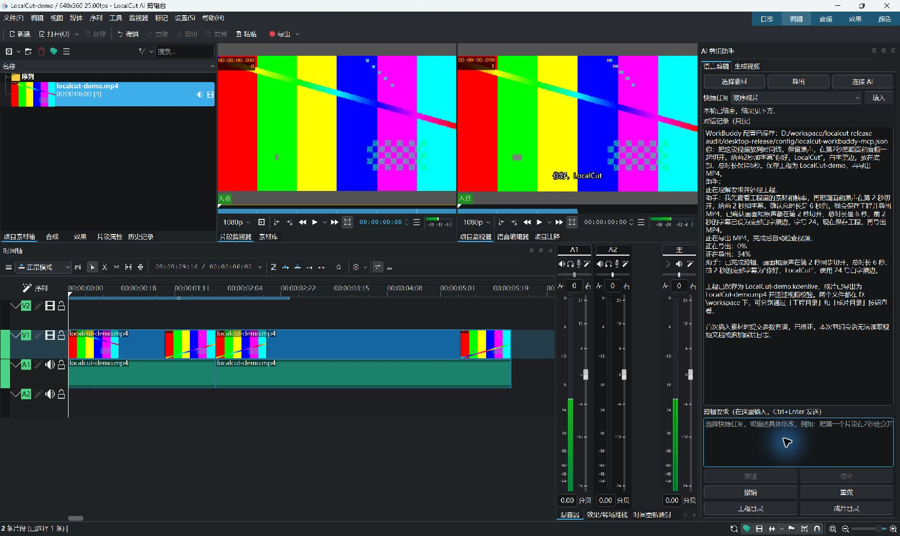

# LocalCut

**Describe your edit. Keep an editable timeline.**

LocalCut is an independent Kdenlive fork with a Chinese natural-language editing assistant. Turn instructions into native timeline operations, review the result, undo a batch, and refine it manually.

[中文](README.md) · [Releases](https://github.com/John201-del/localcut/releases) · [Build from source](docs/BUILD.md) · [Validation scope](docs/VALIDATION.md)



## Highlights

- Native timeline insertion, splitting, trimming, moving, subtitles and effect adjustments through typed editing tools.
- Choose Codex, OpenAI-compatible APIs (including DeepSeek, Qwen and Doubao/Volcengine), local Ollama, or external WorkBuddy control through MCP.
- Project revision checks, transactional edits and grouped undo.
- Eight built-in templates for your own photos and clips.
- Optional local retouching, background removal, vocal separation and cartoon face overlays.
- Optional photo-and-audio talking portraits, plus cloud video generation connectors.
- Kdenlive's existing multitrack editing, keyframes, effects and project format.

## Run on Windows

This is a **Windows x64 development preview**. Use a writable ASCII path; the bundled MLT runtime has a known Unicode installation-path limitation. Windows 11 x64 is the initial validation target.

```powershell
git clone https://github.com/John201-del/localcut.git
cd localcut
.\Start-LocalCut.cmd
```

The launcher downloads pinned application components and third-party runtimes with SHA-256 verification. You do not need a C++ compiler or Python for basic editing. Optional local models require separate installation and several GB of storage.

Manual editing does not require an AI account. For language control, choose **连接 AI** and configure your own Codex login, compatible API endpoint, local Ollama model, or WorkBuddy MCP connection. The selected model must support tool calls; cloud usage belongs to your own account. API keys are kept in memory for the current session. See [AI setup](docs/AI_PROVIDERS.md). The current UI and assistant examples focus on Chinese.

## Boundaries

The cartoon head is a shaded 2D face-tracking effect, not a full 3D avatar rig. Photo pan/zoom and talking portraits are separate operations. Public cloud services can be unavailable or rate-limited; no free quota is guaranteed. Live cloud services and optional models are not covered by every CI run.

Local processing does not mean every feature is offline: the selected AI can receive instructions, project metadata, transcript text and requested thumbnails. Cloud features send relevant inputs to the selected provider.

See the [quick start](docs/QUICKSTART.md), [validation record](docs/VALIDATION.md), [third-party notices](docs/THIRD_PARTY.md) and [contribution guide](CONTRIBUTING.md).

## Credit and license

Built on Kdenlive, MLT, Qt, KDE Frameworks and FFmpeg. This is not an official KDE or OpenAI product. The application is GPL v3; preserve upstream notices and per-file licenses. Models and external assets have their own terms.

If the workflow is useful, a Star helps others discover it. Reproducible bug reports and small improvements are welcome.
