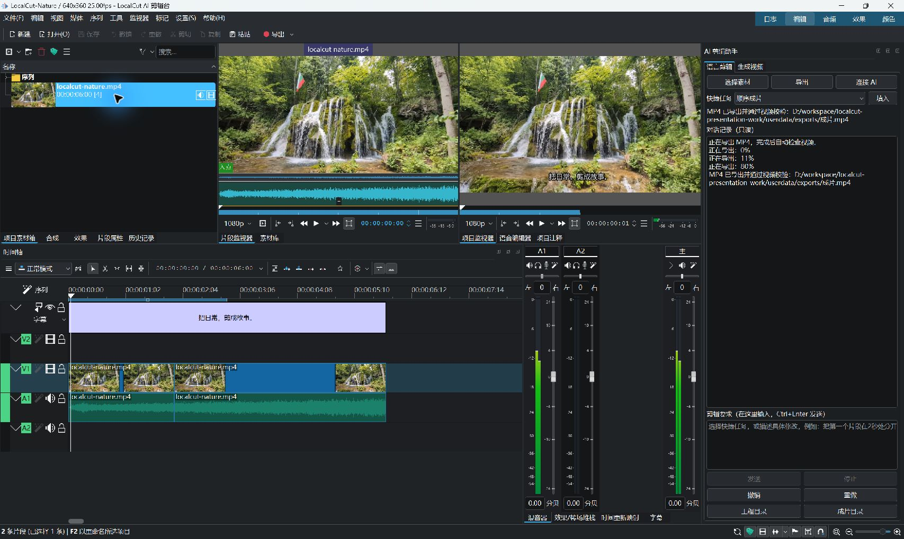

# PhraseSplice

### Describe your edit. Make it yours.

**Tell the AI what you want. Review, refine, or undo its timeline edits.** PhraseSplice is an AI editing workspace for creators. Arrange clips, cut dialogue, add subtitles and apply templates through conversation, with an editable multitrack project you can keep working on.

[](COPYING)
[](https://github.com/John201-del/phrasesplice/actions/workflows/ci.yml)


[中文](README.md) · [Cloud features](#cloud-features) · [Releases](https://github.com/John201-del/phrasesplice/releases) · [Build from source](docs/BUILD.md) · [Validation scope](docs/VALIDATION.md)

> **Windows x64 development preview.** Manual editing needs no AI account. Language control uses your own AI provider or local model; optional media models are installed separately.



*PhraseSplice in use: waterfall footage in the player, alongside the timeline and AI assistant. [Watch or download the MP4 export with audio](docs/assets/localcut-demo.mp4), or [try the source sample](examples/localcut-nature.mp4). See [third-party notices](docs/THIRD_PARTY.md) for footage sources and licenses.*

PhraseSplice was previously named LocalCut. The current Windows preview still shows the old name in the window title and launcher filename.

## Highlights

| What you get | Why it helps |
| --- | --- |
| **Words → editable timeline** | Insert, split, trim and move clips; adjust subtitles and effects on the actual project |
| **Your choice of AI** | Codex, OpenAI-compatible APIs including DeepSeek, Qwen and Doubao/Volcengine, local Ollama, or WorkBuddy through MCP |
| **One batch, one undo** | Project revision checks and transactional edits help you review and roll back changes |
| **Eight built-in templates** | Turn your own photos and clips into photo stories, product showcases, travel chapters and more |
| **Local media tools** | Optional retouching, background removal, vocal separation and face-tracking cartoon overlays |
| **Start with a photo** | Pan/zoom animation, optional photo-and-audio talking portraits, and cloud video generation connectors |
| **Keep refining by hand** | Multitrack editing, keyframes, effects and rendering remain available when you want finer control |

**Import → describe → review → export.** The assistant changes a project you can save, undo and edit again.

## Run on Windows

This is a **Windows x64 development preview**. Use a writable ASCII path; the bundled MLT runtime has a known Unicode installation-path limitation. Windows 11 x64 is the initial validation target.

```powershell
git clone https://github.com/John201-del/phrasesplice.git
cd phrasesplice
.\Start-LocalCut.cmd
```

The launcher downloads pinned application components and third-party runtimes with SHA-256 verification. You do not need a C++ compiler or Python for basic editing. Optional local models require separate installation and several GB of storage.

Manual editing does not require an AI account. For language control, choose **连接 AI** and configure your own Codex login, compatible API endpoint, local Ollama model, or WorkBuddy MCP connection. The selected model must support tool calls; cloud usage belongs to your own account. API keys are kept in memory for the current session. See [AI setup](docs/AI_PROVIDERS.md). The current assistant panel uses Chinese labels; instruction-language support depends on your chosen AI provider and model.

1. Choose **选择素材** to import videos, audio or photos. Try the included [nature footage sample](examples/localcut-nature.mp4) first.
2. Describe a small edit in the assistant, such as `Split the first video at 2 seconds and keep its audio.` With WorkBuddy, enter the request in WorkBuddy instead.
3. Review the timeline and preview, then choose **导出**. Assistant-created projects and exports default to `runtime/userdata/projects` and `runtime/userdata/exports`.

## Cloud features

| Feature | How to use it | Requirements |
| --- | --- | --- |
| **Conversational editing** | Use **连接 AI** to connect Codex, a compatible API such as DeepSeek, Qwen or Doubao/Volcengine, or control the timeline from WorkBuddy through MCP | Use your own Codex login, API credentials or WorkBuddy account as applicable. Compatible models must support tool calls |
| **Text to video** | Choose **生成视频 → LTX** and enter a prompt for a clip of about 4–8 seconds | Uses the [public Lightricks Space](https://huggingface.co/spaces/Lightricks/ltx-video-distilled) with no API key. Shared capacity and availability vary |
| **Text or first-frame image to video** | Choose **生成视频 → Seedance** and enter a prompt, optionally with a starting image | Requires your own Volcengine Ark key and access to the model. Provider charges apply |
| **Mandarin voiceover** | Ask the assistant to generate and import narration from up to 200 Chinese characters | Uses the [public k2-fsa Space](https://huggingface.co/spaces/k2-fsa/text-to-speech). Shared capacity and availability vary |
| **Online media** | Search and import Wikimedia Commons images from the assistant, or use Freesound, Pexels and Pixabay in the editor's online resources panel | Commons search needs no key. The other services require your own credentials. Follow the license for each asset |

The selected AI interprets edit requests. Timeline changes and export run on your computer. The public video option never switches to a paid provider automatically. Templates are built in, and photo lip sync uses an optional local model. See [AI setup](docs/AI_PROVIDERS.md) and [validation scope](docs/VALIDATION.md).

## Boundaries

The cartoon head is a shaded 2D face-tracking effect, not a full 3D avatar rig. Photo pan/zoom and talking portraits are separate operations. Public cloud services can be unavailable or rate-limited; no free quota is guaranteed. Live cloud services and optional models are not covered by every CI run.

Local processing does not mean every feature is offline: the selected AI can receive instructions, project metadata, transcript text and requested thumbnails. Cloud features send relevant inputs to the selected provider.

See the [quick start](docs/QUICKSTART.md), [validation record](docs/VALIDATION.md), [third-party notices](docs/THIRD_PARTY.md) and [contribution guide](CONTRIBUTING.md).

## Help make conversational editing useful

If this is how you want to start editing, **Star** the project and follow upcoming releases. Share the editing task you wish AI could handle, a reproducible bug report, or a focused contribution.

## Credit and license

PhraseSplice is an independent Kdenlive derivative, adding a language assistant, structured editing bridge, templates and local media integrations. Core editing capabilities come from Kdenlive, MLT, Qt, KDE Frameworks and FFmpeg. This is not an official KDE or OpenAI product.

The application is [GPL v3](COPYING); per-file licenses are listed in [LICENSES](LICENSES) and [REUSE.toml](REUSE.toml). [Upstream author credits](AUTHORS) are preserved. Models, fonts, external assets and services have their own terms; see [third-party notices](docs/THIRD_PARTY.md).
